# Architecture

This document describes the components, runtime boundaries, and event flows of
the C++ trading core. The design is inspired by NautilusTrader, but the diagrams
below describe only the components and behavior implemented in this repository.

The editable Mermaid source is
[docs/architecture/architecture.mermaid.md](docs/architecture/architecture.mermaid.md).

## System boundary

One `TradingNode` instance is the live system boundary. It owns the adapter
executor, concrete adapters, and `LiveEventLoop`. Its `TradingKernel` owns the
shared cache, portfolio, engines, message bus, and trader. External adapters may
produce events concurrently, but all mutable trading state is processed serially
on the core thread.

The architecture follows five main rules:

1. `TradingKernel` is the common core and owns every shared trading component.
2. Adapters depend on `EventSink` and `ExecutionClient` ports, not core internals.
3. Every cross-thread event enters through `LiveEventLoop`.
4. Engines update state before publishing an event to strategies.
5. `MessageBus` callbacks run synchronously on the core thread.

## System architecture


Like the upstream NautilusTrader diagram, this view shows logical engine
boundaries. In the live runtime, adapter events first cross `EventSink` and
`LiveEventLoop`, as shown in the threading diagram below.

The diagram uses the same top-level shape as NautilusTrader: adapters surround a
kernel containing the engines, portfolio, trader, cache, and messaging. The
arrows show logical dependencies, not separate worker threads. Every kernel
component and strategy callback runs on the same core thread.

## Component responsibilities

| Component | Responsibility | Does not own |
| --- | --- | --- |
| `TradingNode` | Live runtime, adapter composition, and lifecycle | Trading rules |
| `EventSink` | Adapter-facing port for runtime messages | Scheduling policy |
| `LiveEventLoop` | Unbounded MPSC ingress and batches sorted by priority | Domain validation |
| `TradingKernel` | Common-core ownership and typed runtime dispatch | Venue protocol logic |
| `DataEngine` | Validates data, updates the cache, then publishes | Portfolio accounting |
| `RiskEngine` | Pre-trade validation, trading state, inflight reservations | Venue acceptance |
| `ExecutionEngine` | Execution-client routing and order lifecycle handling | Account calculations |
| `TwapAlgorithm` | Exact child sizing, timer scheduling, primary progress | Venue protocol logic |
| `Scheduler` | Core-thread timed callbacks and cancellation | Trading decisions |
| `Portfolio` | Valuation, fill accounting, positions, PnL, and equity | Long-term persistence |
| `Cache` | In-memory state, indexes, histories, books, atomic fill commit | Accounting policy |
| `MessageBus` | Synchronous typed publish/subscribe on the owner thread | Cross-thread transport |
| `Trader` | Strategy registration, startup, shutdown, and context injection | Engine state |

## Threading and dispatch

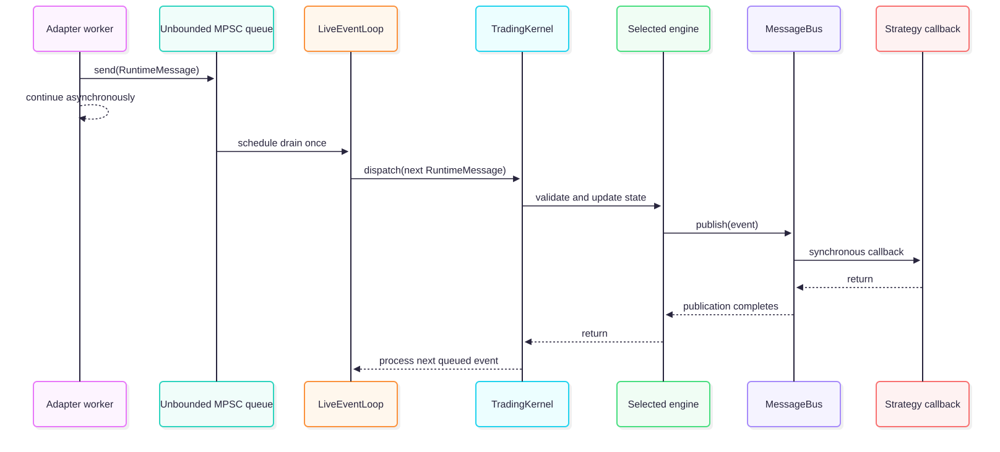

`LiveEventLoop` takes up to 128 messages from its single MPSC queue per batch.
It stably sorts the batch by priority: trading-state changes first, order events
second, and market data last. Messages with equal priority retain their dequeue
order. Messages arriving while a batch executes wait for a later batch; priority
does not move them ahead of queued messages outside the current batch. Full
batches schedule a continuation through `EventBase`, allowing timers and other
callbacks to run between batches. Handler errors stop the loop and propagate
to its caller.

`MessageBus` asserts thread ownership. Strategies call
`context().submitOrder(order)` synchronously on the core thread. The context
invokes `TradingKernel::submitOrder` directly, including routing, risk checks,
and the execution-client call. TWAP targets enter the algorithm synchronously;
its first child is immediate and later children run on core-thread timers.
Orders never enter the event queue; only incoming
market data, lifecycle events, and trading-state events use that queue.

Local route and risk denials publish `OrderDenied` before `submitOrder` returns.
Strategy request state must therefore be established before submission. Venue
acceptance and fills arrive asynchronously through the adapter event queue.

`TradingKernel` registers the portfolio and risk handlers before any strategy
can subscribe. Price events therefore update portfolio valuations, and order
events refresh risk reservations, before strategy callbacks observe them.

## Event routing overview

`RuntimeMessage` is a closed `std::variant`. The following diagram covers every variant
currently accepted by `TradingKernel::dispatch`.


`OrderBookImbalanceSignal` is an internal `MessageBus` publication, not a
`RuntimeMessage` variant. It is produced synchronously by the example
strategy after it reads the updated public book.

## Market-data event flows

### Quote and trade ticks

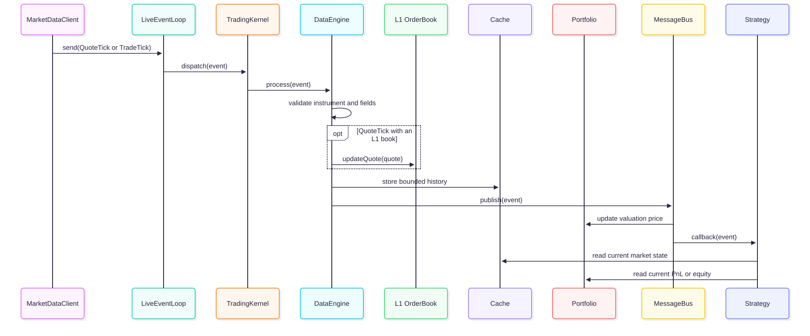

State is current before publication. Long positions use the bid and short
positions use the ask. Without a quote, valuation falls back to the latest
trade and then the latest accepted bar close.

### Bars

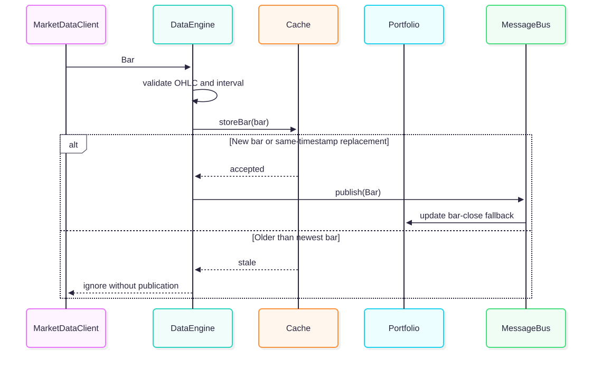

### Public order books

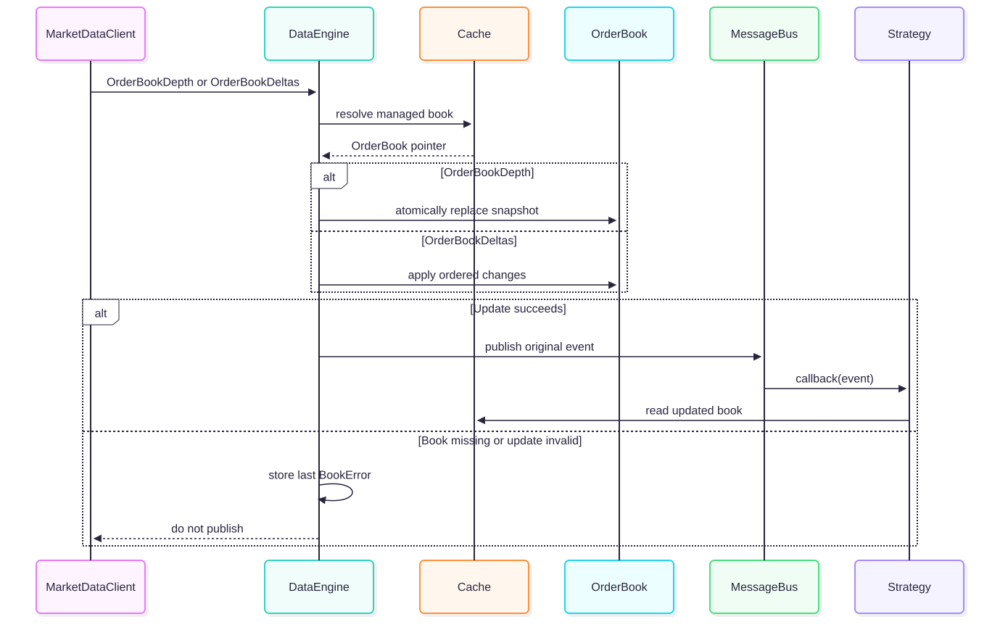

## Order event flows

### Submit order

This path describes direct orders and each child submitted by TWAP. TWAP primary
orders enter the algorithm first, rather than being sent to an execution client.

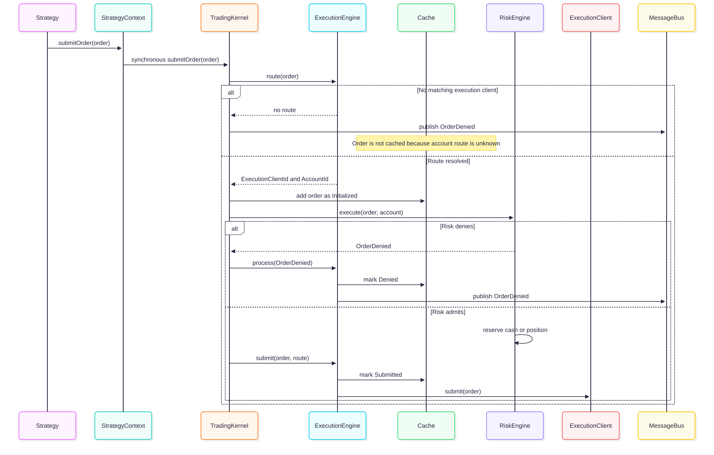

`SubmitOrder` is a request passed directly to the synchronous submission API;
it is not a `RuntimeMessage`. The call returns after local processing and client
submission, while venue acceptance and fills still arrive later as events.

Routing priority is explicit `ExecutionClientId`, then the client registered for
the instrument venue, then the default client. The selected client determines
the account used by risk, accounting, and order indexes.

### Accepted, updated, canceled, denied, rejected, and expired

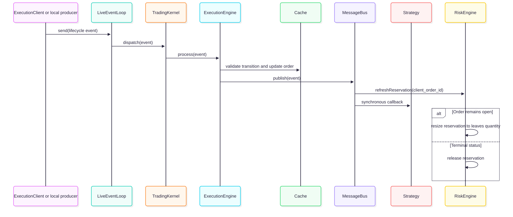

This shared path covers:

- `OrderAccepted`: submitted to accepted, records the venue order ID.
- `OrderUpdated`: changes quantity, price, and leaves quantity for an open order.
- `OrderCanceled`: moves an open order to canceled.
- `OrderDenied`: records a local risk failure for a cached order.
- `OrderRejected`: records an external venue or broker rejection.
- `OrderExpired`: moves an open order to expired.

Local route failure is the exception: because no execution client and account
can be resolved, `TradingKernel` publishes `OrderDenied` directly without adding
an order to the cache.

### Filled

`OrderFilled` has a stronger consistency boundary than other lifecycle events
because one fill changes the order, account, and position together.

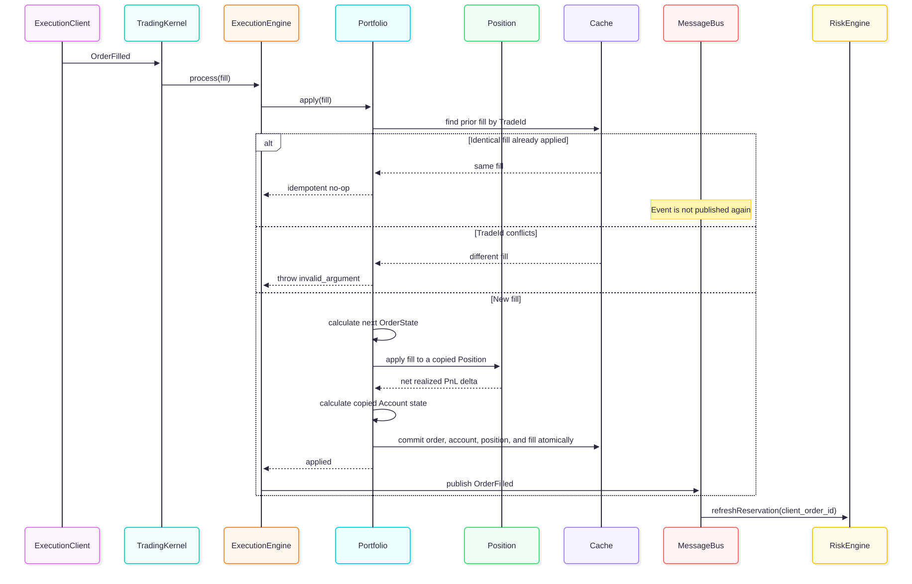

All validation and allocation completes before the cache changes domain state.
If price, quantity, fee currency, balance, or arithmetic validation fails, the
order, account, position, and fill registry remain unchanged.

## Control event flows

### Trading state

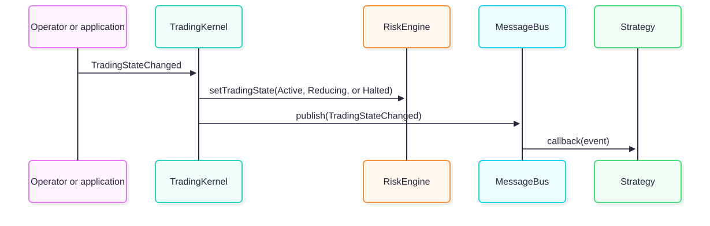

`Active` permits orders that pass normal validation. `Reducing` permits only
valid reduce-only orders. `Halted` denies every new order.

### Shutdown

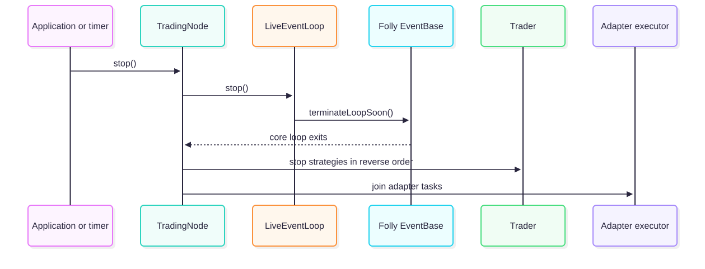

Shutdown is a runtime lifecycle operation, not a domain event in
`RuntimeMessage`.

## Strategy lifecycle and internal signals

Strategies are registered only while the trader is `Ready`. Startup follows
registration order; shutdown and partial-start rollback use reverse order.
Strategies subscribe to typed `MessageBus` events during `start()` and may
publish internal signals synchronously.

The included order-book imbalance strategy follows this path:

## State consistency guarantees

- The core thread serializes all engine and strategy state transitions.
- Market data and books are updated before their events are published.
- Execution lifecycle state is updated before strategy callbacks run.
- A new fill commits order, account, position, and fill identity as one logical
  transition.
- Exact fill replay is idempotent; conflicting reuse of a trade ID is rejected.
- Missing valuation prices produce `std::nullopt`, not a zero valuation.
- Prices, quantities, money, PnL, and fees use fixed-point arithmetic.
- `Money` rejects arithmetic across different currencies.

These guarantees are in-memory guarantees. The current core has no durable
cache backing, event store, startup reconciliation, or external message-bus
backing.

## Current scope compared with NautilusTrader

The component boundaries intentionally resemble NautilusTrader, but this core
implements a smaller surface:

- One serialized runtime context, with no separate backtest/live kernels.
- Typed in-process publish/subscribe only; no request/response or external bus.
- In-memory cache only; no database persistence or restart reconstruction.
- Public order books only; no own-order book.
- Net positions only; no hedging OMS or multiple position IDs per instrument.
- Cash-style linear accounting only; no FX conversion, derivative settlement,
  inverse/quanto PnL, margin, leverage, or liquidation model.
- No execution reconciliation, emulation, or throttling.
- One limit-order TWAP algorithm; no market-order pricing or automatic child retries.

Unsupported behavior should be rejected explicitly rather than approximated by
the implemented cash and linear-product rules.

## TWAP execution

The kernel owns an optional `TwapAlgorithm` when a scheduler is configured.
`TradingNode` supplies `LiveEventLoop` as the scheduler. Algorithm child orders
call the existing synchronous routing/risk/execution path directly.

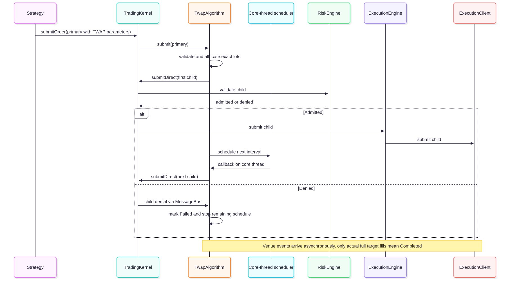

The primary's `TwapExecutionState` is separate from cached venue orders. Child
IDs use the primary ID plus `-E1`, `-E2`, etc.; each child records `exec_spawn_id`.
The primary is never sent to the venue in addition to its children.

Planned quantity is conserved with integer lot arithmetic. The requested number
of slices is `floor(horizon / interval)`, reduced when required by minimum child
quantity. Maximum child quantity and timer/resource bounds are checked before
execution. Children retain the primary limit price and require IOC or FOK.

A denial or an unfilled terminal child stops subsequent submissions and marks
the primary execution `Failed`. A changed child quantity or limit price also
stops the schedule. Automatic retries and restoration of unfilled child quantity
are not implemented. Progress continues to reflect fills of already submitted
children after a stop or failure.

`cancelTwap` cancels future scheduling, not venue orders. Runtime shutdown stops
algorithm timers and prevents new targets. A delayed timer sends one child,
then waits another interval; it does not issue a catch-up burst.
